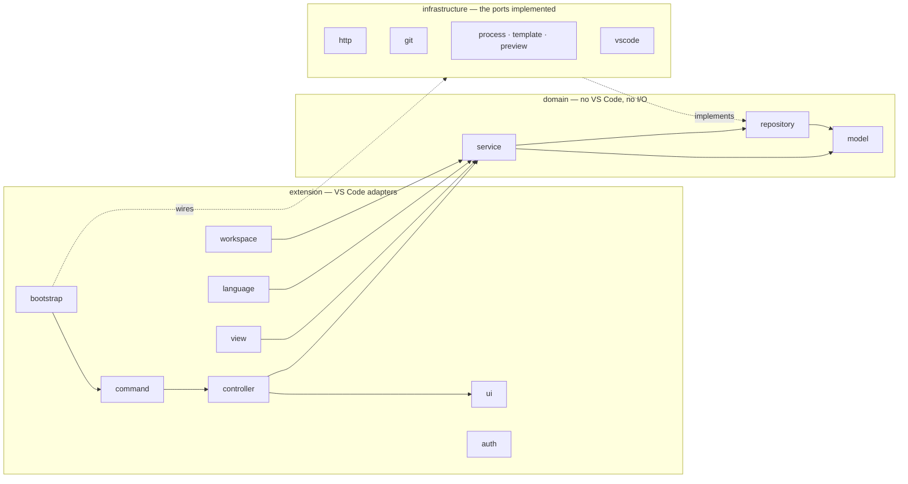

# Structure

The toolbox is a domain core with adapters around it. Dependencies point one way only,
and ESLint (`no-restricted-imports` per folder) refuses an import that goes the wrong way.

## Layers

### `src/domain/` — what the toolbox knows and decides

Nothing in the domain imports `vscode`, `node:*`, `fetch`, `infrastructure/` or
`extension/`. It is unit tested with plain `node --test`.

| Sub-layer | Holds | May import |
|---|---|---|
| `model/` | Entities and value objects: classes with behaviour (`Version`, `Marker`, `LuaHeader`, `Metadata`, `Platform`, `Project`, `ProjectPlan`, `AssetChecklist`, `Changelog`, `Makefile`) and the plain data the host sends (`Software`, `Release`, `PipelineRun`, …). | `model/` |
| `repository/` | Ports: interfaces only, for everything outside the process — the host API, git, the project's files, the template archives, the shell, the stored sessions, the settings, the preview server. | `model/` |
| `service/` | One class per business capability, on models and ports: `ReleaseService`, `ConnectService`, `ScaffoldService`, `RemoteStateService`, `PlayService`, `SyncService` (pairing two engines), `ImageService`, `ServerService` (the local containers and their purge), `HostInfoService`, … Every decision lives here: what is missing for a release, which versions to offer, what the host would refuse. A service never asks the user anything. | `model/`, `repository/` |

A domain failure is a `DomainError` carrying a `Message` (an English text with `{0}`
placeholders and its arguments); the extension translates it.

### `src/infrastructure/` — the ports implemented

| Folder | Implements |
|---|---|
| `http/` | `WarpEngineHttpClient` (fetch, errors, the admin envelope) and the HTTP repositories on it: build, catalog, pipeline, sign-in; `WarpEngineHttpGateway` hands them out for the current host and token. |
| `git/` | `SourceControl` with the `git` CLI. |
| `process/` | Running a command (`execFile`) and a shell line; `ContainerRuntime` with the `docker` CLI (the Servers view, the purge). |
| `template/` | `TemplateRepository`: a repository's archive downloaded and unpacked. |
| `preview/` | `PreviewServer`: the loopback HTTP server Play uses. |
| `vscode/` | The ports whose natural home is VS Code: the settings (hosts), the secret storage (sessions), the memento (platform cache), the workspace file system, the authentication session (token). The only infrastructure folder that may import `vscode`. |

Infrastructure imports `domain/model` and `domain/repository`, never `domain/service` or
`extension/`.

### `src/extension/` — VS Code adapters

| Folder | Holds |
|---|---|
| `bootstrap/` | `main.ts` (`activate`/`deactivate`), `container.ts` (the composition root: the only file that creates infrastructure objects) and `toolbox.api.ts` (what `activate` returns to the tests). |
| `command/` | The command table: command id → controller method, with one error handler. |
| `controller/` | One class per user flow, thin: asks the user, calls services, reports. No decisions of its own — when a controller grows an `if` about the business, it moves into a service. |
| `ui/` | Small helpers the controllers share: quick picks with values, progress, notifications with actions, the translation of a `Message`. |
| `auth/` | The VS Code authentication provider on `SignInService`. |
| `workspace/` | Living state of the window: `ProjectRegistry` (the projects of the workspace folders, the current one), `RemoteStateStore` (polling and events), `GitWatcher`. |
| `view/` | What is drawn: the tree views and their nodes, the status bar, the Play panel, the metadata form, the diagnostics, the report documents, the platform description. |
| `language/` | Editor features: marker completion, hover and lens, the metadata JSON schema, the Makefile task provider, the MCP server definition. |

The extension may import every domain sub-layer. It does not import `infrastructure/`,
except `bootstrap/container.ts`.

## Naming

- Files: `<subject>.<role>.ts`, kebab-case subject. The role is the layer or the kind:
  `version.model.ts`, `catalog.repository.ts` (port), `catalog.http-repository.ts`
  (an implementation: `<subject>.<technology>-repository.ts`), `release.service.ts`,
  `release.controller.ts`, `project.tree-view.ts`, `pipeline.status-bar.ts`,
  `marker.completion-provider.ts`.
- Classes carry their role as a suffix: `ReleaseService`, `ReleaseController`,
  `CatalogRepository` (interface), `HttpCatalogRepository`, `ProjectTreeView`.
- Tests mirror the source: `test/unit/domain/model/version.model.test.ts`.
- Webview assets are real files in `media/webview/` (`metadata-form.js`,
  `metadata-form.css`, `play-toolbar.js`, `play.css`), never strings in TypeScript.

## Size

ESLint keeps the code small: at most 25 lines per function, 200 lines per file,
complexity 8, 4 parameters (more travel as one input object).

## A request, end to end: Release…

1. `command/command.registry.ts` maps `warpengine.release` to `ReleaseController.run()`.
2. `ReleaseController` takes the current project from `ProjectRegistry` and asks
   `ReleaseService.readiness()`: a repository with a remote, a clean working copy, a
   version the toolbox can write. It shows what is missing, or offers to commit first.
3. It asks for the channel, then offers `ReleaseService.candidates()` (from the `Version`
   model); `ReleaseService.verify()` asks the host through `BuildRepository.check()`.
4. `ReleaseService.release()` writes the version with `Metadata` through `ProjectFiles`,
   builds the `Changelog` from the `SourceControl` commits, commits, tags and pushes.
5. The controller reports; `RemoteStateStore.watch()` starts polling the pipeline, and the
   tree view and the status bar redraw from its event.

## Adding things

- **A command**: a controller method (or a new `<flow>.controller.ts`), a row in
  `command.registry.ts`, the contribution in `package.json` with `%key%` titles, the texts
  in `package.nls*.json`.
- **A host endpoint**: the method on the port in `domain/repository/`, its HTTP
  implementation in `infrastructure/http/`, then use it from a service.
- **A tree node**: in the matching `view/tree/*.tree-view.ts`; it reads services or the
  stores, never the HTTP client.

## i18n

- English is the base language, Hungarian the first translation.
- `package.json` texts are `%key%` references to `package.nls.json` and
  `package.nls.hu.json`.
- Runtime texts go through `vscode.l10n.t` with the bundles `l10n/bundle.l10n.json`
  (English) and `l10n/bundle.l10n.hu.json`; the key is the English text with `{0}`
  placeholders.
- The domain never translates: a `DomainError` carries a `Message`, and
  `extension/ui` turns it into text with the same bundles.
- Webviews get their texts from the extension when they are created.
- What the toolbox writes into a project (README, the marker comment, the changelog,
  commit messages) stays English: it belongs to the project, not to the editor.
- `npm run l10n:check` fails when a translated text has no Hungarian translation; it runs
  with the unit tests.
